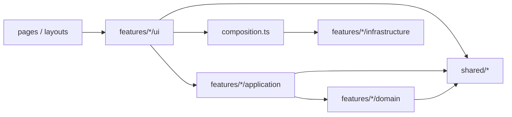

<div align="center">

# Monteiro Veloso Advogados ⚖️

**Institutional website and vehicle repossession defense landing page for a law firm in Salvador, Bahia — static, SEO-first, and LGPD-aware.**

[](https://github.com/felipevenas/landing-monteiro-veloso/actions/workflows/ci.yml)
[](https://astro.build/)
[](https://react.dev/)
[](https://www.typescriptlang.org/)
[](https://tailwindcss.com/)
[](https://nodejs.org/)
[](LICENSE)

<br />

<p align="center">
  <a href="#overview"><b>Overview</b></a> •
  <a href="#stack"><b>Stack</b></a> •
  <a href="#architecture"><b>Architecture</b></a> •
  <a href="#quick-start"><b>Quick Start</b></a> •
  <a href="#configuration"><b>Configuration</b></a> •
  <a href="#features"><b>Features</b></a> •
  <a href="#testing"><b>Testing</b></a> •
  <a href="#deployment"><b>Deployment</b></a> •
  <a href="#known-limitations-mvp-trade-offs"><b>Limitations</b></a> •
  <a href="#governance"><b>Governance</b></a>
</p>

</div>

---

> **Production:** [monteiroveloso.com](https://monteiroveloso.com) ·
> **Repository:** [felipevenas/landing-monteiro-veloso](https://github.com/felipevenas/landing-monteiro-veloso) ·
> **Client:** Monteiro Veloso Advogados — Salvador, Bahia, Brazil

## Overview

Monteiro Veloso Advogados is a law firm focused on consumer banking law and the defense of individuals against banks and finance companies. Its public site serves prospective clients in Salvador and, through online appointments, across Brazil. This repository owns the complete public web presence described below.

| Area                  | What this repository owns                                                                                    |
| --------------------- | ------------------------------------------------------------------------------------------------------------ |
| Institutional site    | The home page with practice areas, Google reviews, Instagram content, location, business hours, and contact. |
| Campaign landing page | An independent vehicle repossession defense page with its own narrative, anchors, SEO metadata, and FAQ.     |
| Trust and legal       | A privacy policy page, a real 404 page with `noindex`, and OAB-aware content rules.                          |
| Lead capture          | A React contact-form island with client-side validation, LGPD consent capture, and two delivery modes.       |
| Privacy engineering   | Opt-in consent, denied-by-default Google Consent Mode v2, attribution capture, and gated third-party embeds. |
| Discoverability       | Canonical URLs, Open Graph/Twitter metadata, JSON-LD, sitemap, robots, and build-time SEO validation.        |
| Release quality       | Strict launch checks, artifact checks, unit tests, E2E tests, and CI.                                        |

This is a **static site**. It has no database, authentication, CMS, or Node.js runtime in production. Content is versioned in the repository and deployed as generated HTML, CSS, JavaScript, images, fonts, and configuration files.

> This is a private client project. Documentation describes capabilities and architecture without exposing client contact data, registration numbers, credentials, or other sensitive details.

## Stack

Versions are verified against `package.json` and `package-lock.json`.

| Layer              | Technology                                                                                            | Version                          |
| ------------------ | ----------------------------------------------------------------------------------------------------- | -------------------------------- |
| Framework          | Astro, `output: 'static'`, `trailingSlash: 'always'`, `build.format: 'directory'`                     | 7.4.1                            |
| UI island          | React + `@astrojs/react`, used only by the contact form (`client:visible`)                            | React 19.3.1 · integration 7.1.0 |
| Language           | TypeScript, intentionally pinned because the Astro/ESLint toolchain does not yet support TypeScript 7 | 6.0.3                            |
| Styling            | Tailwind CSS through `@tailwindcss/vite`, with design tokens in `src/styles/global.css`               | 4.3.3                            |
| Icons              | `astro-icon` with the Lucide icon set                                                                 | 1.2.0 · Lucide 1.2.147           |
| SEO                | `@astrojs/sitemap`                                                                                    | 3.7.4                            |
| Unit tests         | Vitest                                                                                                | 5.0.5                            |
| E2E tests          | Playwright, Chromium desktop and Pixel 7 projects                                                     | 1.64.1                           |
| Lint and format    | ESLint 10 with `typescript-eslint` and `eslint-plugin-astro`; Prettier 3 with the Astro plugin        | 10.13.0 · 3.9.10                 |
| Build tooling      | `tsx` scripts and `sharp` for image processing                                                        | 4.23.15 · 0.35.5                 |
| Runtime for builds | Node.js `>=22.22.0` (Astro engine requirement), validated with Node 24.11 and npm 10+                 | —                                |

## Architecture

The site is organized by **route composition** and **feature modules**. Pages assemble layouts and features; features own their content, rules, adapters, and presentation.

```text
src/
├── pages/                     route composition only
│   ├── index.astro            institutional home
│   ├── defesa-busca-e-apreensao-veiculo/
│   ├── politica-de-privacidade/
│   └── 404.astro
├── layouts/                   BaseLayout, LandingLayout, LegalLayout
├── features/
│   ├── home/                  home content and sections
│   ├── busca-apreensao/       campaign landing content and sections
│   ├── privacy/               privacy policy content
│   ├── contact-form/          domain → application → infrastructure → React UI
│   ├── consent/               LGPD decision, storage, banner, consent event
│   ├── analytics/             GTM/Noop strategy, Consent Mode, events
│   ├── attribution/           UTMs, gclid, fbclid, msclkid in sessionStorage
│   ├── reviews/               Google Places mapping, curated fallback, carousel
│   ├── instagram/             consent-gated embeds and fallbacks
│   ├── whatsapp/              link and floating action button
│   ├── map/                   click-to-load office map
│   └── ...                    shared feature entry points via index.ts
├── shared/
│   ├── config/                site data, routes, public env, config fields
│   ├── seo/                   metadata, Seo.astro, JSON-LD builders
│   ├── ui/                    buttons, sections, headings, header, footer, map
│   ├── domain/                small pure primitives
│   └── lib/                   class-name and HTML helpers
└── styles/global.css          Tailwind entry point and design tokens
```

Supporting directories:

```text
scripts/          launch checks, dist checks, Google reviews, map and asset generation
tests/unit/       Vitest domain and application tests
tests/e2e/        Playwright suites and a local webhook mock
public/           .htaccess, fonts, OG images, favicon, and the consent/attribution boot script
docs/             architecture, design, deployment, n8n contract, QA, and ADRs
```

### Feature layers and boundaries

Every feature with logic follows the same dependency direction:



| Layer            | Responsibility                                              | Must not                                                           |
| ---------------- | ----------------------------------------------------------- | ------------------------------------------------------------------ |
| `domain`         | Types, pure rules, validation primitives, `Result`          | Import Astro, React, Zod, `fetch`, or `window`                     |
| `application`    | Use cases, ports, input validation, message/payload mapping | Import UI or concrete adapters                                     |
| `infrastructure` | n8n and mailto gateways, storage adapters                   | Own presentation or business rules                                 |
| `ui`             | Astro/React components, accessibility, states               | Import infrastructure directly; that goes through `composition.ts` |
| `shared`         | Cross-cutting config, SEO, UI primitives, styles            | Import `features`, `pages`, or `layouts`                           |

These boundaries are enforced by ESLint `no-restricted-imports` rules in [`eslint.config.js`](eslint.config.js), not only by convention.

### Rendering and hydration

- Astro renders every page to static HTML at build time.
- React hydrates **only** the contact form, using `client:visible` with a `300px` root margin.
- Consent, attribution, analytics, maps, reviews, and Instagram behavior are implemented in small client scripts or Astro components.
- There is no SSR, middleware, route handler, or API route in this repository.

### Content and configuration as data

- Firm identity, lawyer details, address, contact links, navigation, and launch-critical fields live in [`src/shared/config/site.ts`](src/shared/config/site.ts).
- Routes are centralized in [`src/shared/config/routes.ts`](src/shared/config/routes.ts).
- Public environment values are normalized in [`src/shared/config/env.ts`](src/shared/config/env.ts).
- Pending content uses `ConfigField` + `publishable()` so `[PREENCHER]` is never rendered into a production page.
- Page copy lives in each feature's `content.ts`; pages only compose sections.

## Quick Start

### Prerequisites

- **Node.js >= 22.22.0** — required by the Astro version in the lockfile; validated with Node 24.11.
- **npm >= 10**.
- No backend service is required for local development.

### 1. Clone, install, and configure

```powershell
git clone https://github.com/felipevenas/landing-monteiro-veloso.git
cd landing-monteiro-veloso
npm install
Copy-Item .env.example .env
```

On macOS/Linux, use `cp .env.example .env` instead of `Copy-Item`.

`.env.example` contains development placeholders only. Never commit real credentials.

### 2. Start the development server

```powershell
npm run dev
```

Open **http://localhost:4321**.

The development server does not run the strict production pre-build gates, so it starts even when launch fields are still pending. The production build is intentionally stricter.

### 3. Validate a production-like build

```powershell
npm run build:preview
npm run preview
```

`build:preview` allows placeholders and missing Google reviews so the site can be reviewed before launch data is complete. **Do not deploy a preview build to production.**

### 4. Run the quality gates

```powershell
npm run format:check
npm run lint
npm run typecheck
npm test
npm run test:e2e
npm run build
```

`npm run build` requires all launch-critical values described in [Configuration](#configuration).

## Configuration

All `PUBLIC_*` variables are **embedded into the client bundle at build time**. They are public by definition. Never put API keys, tokens, or private credentials in a `PUBLIC_*` variable.

Values are read from `.env` during development and build. `check:launch`, `fetch:reviews`, and `check:dist` load the production environment through Vite.

### Public runtime configuration

| Variable                 | Required                     | Default / example  | Description                                                                                                                                               |
| ------------------------ | ---------------------------- | ------------------ | --------------------------------------------------------------------------------------------------------------------------------------------------------- |
| `PUBLIC_LEAD_DELIVERY`   | No                           | empty → automatic  | `mailto` opens the visitor's email app; `webhook` sends a `POST` to n8n. When empty, the site uses `webhook` if a webhook URL exists, otherwise `mailto`. |
| `PUBLIC_N8N_WEBHOOK_URL` | Only for `webhook` mode      | empty              | Public n8n endpoint that receives leads. The URL is not a secret; protect n8n with rate limiting, validation, and deduplication.                          |
| `PUBLIC_GTM_ID`          | No                           | empty              | Google Tag Manager container ID (`GTM-XXXXXXX`). Without it, analytics runs in Noop mode.                                                                 |
| `PUBLIC_FORM_ENABLED`    | No                           | `true`             | When `false`, the form is disabled and the WhatsApp fallback remains available.                                                                           |
| `PUBLIC_CONSENT_VERSION` | No                           | `2026-10.1`        | Version of the LGPD consent text accepted by the form. Changing the consent scope should change this value so visitors are asked again.                   |
| `PUBLIC_N8N_TIMEOUT_MS`  | No                           | `12000`            | Timeout for the webhook `POST`, in milliseconds.                                                                                                          |
| `GOOGLE_PLACES_API_KEY`  | **Yes for production build** | empty              | Google Places API (New) key used **only at build time** to fetch reviews. Never use the `PUBLIC_` prefix and never expose it to the browser.              |
| `GOOGLE_PLACE_ID`        | No (override)                | `site.geo.placeId` | Optional override for the Google Place ID configured in `src/shared/config/site.ts`.                                                                      |

### Launch-critical content

The strict production build also validates fields in `src/shared/config/site.ts`:

| Field                             | Requirement                                       |
| --------------------------------- | ------------------------------------------------- |
| `site.lawyer.oab`                 | Required. Responsible lawyer's OAB registration.  |
| `site.hours`                      | Required. Public business hours.                  |
| `site.geo.placeId`                | Required (or supplied through `GOOGLE_PLACE_ID`). |
| `site.address.room`               | Optional warning.                                 |
| `site.geo.latitude` / `longitude` | Optional warnings.                                |
| `site.email`                      | Required when the form uses `mailto` mode.        |

The current repository contains real launch values for the required content fields. Do not copy client-specific values into other projects.

### Environment safety

- Never commit `.env`, private keys, API keys, or real credentials.
- `PUBLIC_*` values are visible in the generated JavaScript. Treat them as public.
- The Google Places key is build-only. `check:dist` fails if the literal key or a Google API key pattern appears in `dist/`.
- The n8n webhook URL is public by nature; real protection must live in the webhook workflow and the edge proxy in front of it.
- `check:dist` also rejects `NEXT_PUBLIC_` variables, source maps, localhost URLs, invalid UTF-8, and the `U+FFFD` replacement character.

## Features

### Routes

| Route                                | Purpose                                                                                          |
| ------------------------------------ | ------------------------------------------------------------------------------------------------ |
| `/`                                  | Institutional home. Sections: `#areas`, `#avaliacoes`, `#instagram`, `#localizacao`, `#contato`. |
| `/defesa-busca-e-apreensao-veiculo/` | Independent campaign landing page with its own anchors, narrative, FAQ, and metadata.            |
| `/politica-de-privacidade/`          | LGPD privacy policy and the channel for data-rights requests.                                    |
| `/404.html`                          | Real not-found page with `noindex`.                                                              |

The home page deliberately does not promote the campaign landing in its main navigation. The landing page is reached through campaign traffic and a footer link.

### Lead capture

The contact form is the only React island and is shared by the home page and the landing page. It receives page-specific copy and a `source` value.

| Behavior         | Implementation                                                                                                                            |
| ---------------- | ----------------------------------------------------------------------------------------------------------------------------------------- |
| Validation       | Name, Brazilian WhatsApp number with area code, situation, and LGPD consent.                                                              |
| Abuse resistance | Honeypot field, time-trap, and duplicate-submit blocking.                                                                                 |
| `mailto` mode    | Builds a complete message and opens the visitor's email application with the firm's address fixed as recipient.                           |
| `webhook` mode   | Sends `application/json` to n8n with lead data, consent version/timestamp, attribution, page, source, timestamps, and an idempotency key. |
| Success          | `200`, `201`, and `202` are treated as accepted in webhook mode.                                                                          |
| Failure          | Validation errors, rate limits, timeouts, and `5xx` responses show a recoverable state with a WhatsApp fallback.                          |
| Privacy          | No credentials are sent from the browser. Deduplication and rate limiting are delegated to n8n/Cloudflare.                                |

### LGPD consent and analytics

- Google Tag Manager **does not load before opt-in**.
- Google Consent Mode v2 starts with `analytics_storage`, `ad_storage`, `ad_user_data`, and `ad_personalization` denied.
- Allowed events are `click_whatsapp`, `form_submit`, and `scroll_75`.
- No personally identifiable information is pushed to the `dataLayer`.
- The decision is stored in `localStorage` under `mv_consent_v1` and can be reopened from the footer's cookie preferences action.
- Instagram embeds and the office map load only after consent or explicit user action, with visible fallbacks when third parties are unavailable.

### Attribution

Campaign parameters (`utm_*`, `gclid`, `fbclid`, `msclkid`) and the landing page/referrer are captured in `sessionStorage` under `mv_attribution_v1`. They are attached to the lead payload so the firm can understand which campaign generated the contact without adding PII to analytics.

### SEO and structured data

- Absolute canonical URLs with trailing slashes.
- Open Graph and Twitter metadata with a 1200×630 image.
- JSON-LD graph: `LegalService`, `Person`, `WebSite`, and `WebPage` on the home; `BreadcrumbList` on the landing and privacy pages; `FAQPage` on the landing page.
- Sitemap generated at build time and excludes the 404 page.
- `robots.txt` points to the sitemap index.
- The 404 page is `noindex`.
- `lang="pt-BR"` on the public pages.
- `check:dist` enforces one H1 per page, a title, a meta description, a canonical URL, valid JSON-LD, no `aggregateRating`/`review`/`priceRange`, a real 404, and no placeholders in a production artifact.

### Google reviews

- `npm run fetch:reviews` calls the Google Places API (New) at build time and writes `src/features/reviews/data/reviews.json`.
- The review payload is treated as fresh for 30 days; when it expires, the curated fallback in `reviews.curated.json` is used.
- The API returns at most five reviews. The UI carousel remains keyboard-operable and includes a public Google profile link.
- Reviews are presented as client opinions and never as a promise of result, in line with OAB advertising rules.

### Design and accessibility

- Editorial legal design: Playfair Display for headings, Manrope for body text, navy/paper palette, thin rules, and photography used as structure rather than decoration.
- Two visual rhythms: a light institutional home and a darker, campaign-oriented landing page.
- Design tokens are centralized in `src/styles/global.css`; avoid magic colors and spacing in markup.
- Keyboard navigation, visible focus, AA contrast, semantic labels, `aria-invalid`, live regions, and `prefers-reduced-motion` are part of the definition of done.
- Responsive behavior is tested from 320 px to 2560 px.

## Scripts

| Command                 | Purpose                                                                                                           |
| ----------------------- | ----------------------------------------------------------------------------------------------------------------- |
| `npm run dev`           | Start the Astro development server on `:4321`.                                                                    |
| `npm run start`         | Alias for `astro dev`.                                                                                            |
| `npm run build`         | Strict production build: `check:launch` → `fetch:reviews` → `astro check` → `astro build` → `check:dist`.         |
| `npm run build:preview` | Preview build with placeholders and missing reviews allowed. Never deploy as production.                          |
| `npm run preview`       | Serve the generated `dist/`.                                                                                      |
| `npm run check:launch`  | Validate launch-critical content and environment values. Fails the strict build.                                  |
| `npm run check:dist`    | Validate the generated artifact: files, charset, canonical, JSON-LD, 404, sitemap, placeholders, and leaked keys. |
| `npm run fetch:reviews` | Refresh the Google reviews cache at build time.                                                                   |
| `npm run generate:map`  | Regenerate the Brazil map SVG data from the committed CC0 dataset.                                                |
| `npm run lint`          | ESLint with feature and layer boundaries.                                                                         |
| `npm run format`        | Format with Prettier and the Astro plugin.                                                                        |
| `npm run format:check`  | Check formatting without writing.                                                                                 |
| `npm run typecheck`     | Run `astro check`.                                                                                                |
| `npm test`              | Run Vitest once.                                                                                                  |
| `npm run test:watch`    | Run Vitest in watch mode.                                                                                         |
| `npm run test:e2e`      | Run Playwright with a local webhook mock and dev server on `:4322`.                                               |

## Testing

| Suite               | Coverage                                                                                                                                                                                                                                           |
| ------------------- | -------------------------------------------------------------------------------------------------------------------------------------------------------------------------------------------------------------------------------------------------- |
| Unit (`tests/unit`) | Consent parsing and persistence, Google review mapping and curation, lead validation, mailto message composition, and phone/name normalization.                                                                                                    |
| E2E (`tests/e2e`)   | Landing metadata and FAQ, reviewed copy, consent gating, map-on-click, form submission to a mock webhook, mobile navigation, WhatsApp button, Instagram consent/fallback, home sections, privacy page, 404, and responsive overflow at ten widths. |
| Build checks        | `check:launch` blocks incomplete production builds; `check:dist` validates the final artifact.                                                                                                                                                     |

The Playwright configuration starts two local services: a mock webhook on `:4444` and the Astro dev server on `:4322`. The suite runs against Chromium desktop and a Pixel 7 profile. It does not call live Google or n8n services.

### CI

The GitHub Actions workflow runs on Node 22.x and 24.x:

1. `npm ci`
2. `npm run format:check`
3. `npm run lint`
4. `npm run typecheck`
5. `npm test`
6. `npm run build:preview`
7. Playwright Chromium E2E on Node 24.x

The Playwright HTML report is uploaded as a workflow artifact for seven days. All gates must stay green before merging.

## Deployment

Production is a static deployment at **https://monteiroveloso.com**. The primary operational runbook targets **Hostinger** (`public_html` on Apache/LiteSpeed); a [`vercel.json`](vercel.json) is also included for Vercel-based hosting and previews.

### Hostinger (primary runbook)

1. Complete all launch-critical fields and environment values.
2. Run `npm run build`.
3. Upload **the contents of `dist/`** — not the `dist` folder itself — to `public_html/`.
4. Include the hidden `.htaccess` file. If the file manager hides it, use FTP/SSH.
5. Confirm HTTPS, the `www` → non-`www` redirect, the real 404 page, the sitemap, and a real form submission.

The generated `.htaccess` provides UTF-8 defaults, HTTPS/canonical redirects, compression, cache policy, security headers, and a real 404 document. It also ships a **Content-Security-Policy in Report-Only mode**; promote it to enforce mode only after validating GTM/GA4, Google Maps, Instagram, and the n8n host.

HSTS is intentionally commented out until every subdomain is confirmed to use HTTPS.

### Vercel

`vercel.json` builds with `npm run build`, publishes `dist/`, marks `*.vercel.app` deployments as `noindex, nofollow`, redirects `www.monteiroveloso.com` to the canonical domain, and blocks direct access to `.htaccess`. Provide the same build-time environment variables in the Vercel project.

### Operational notes

- HTML is served with `no-cache, must-revalidate`.
- Hashed `_astro` assets are cached immutably for one year.
- Fonts and images use long-lived caches; public images use 30 days.
- Keep the previous `dist/` artifact for rollback. Because HTML is not cached for long, a rollback is a file replacement.
- The site has no server runtime; hosting only needs to serve static files.

## Known Limitations (MVP Trade-offs)

This section is deliberately explicit. These are conscious project decisions and operational boundaries, not hidden behavior.

### Lead delivery

- **`mailto` mode has no delivery confirmation.** The browser opens the visitor's email application; the message only exists after the visitor sends it. The success screen therefore instructs the visitor to send the message and keeps WhatsApp as a fallback.
- In `mailto` mode there is no server-side validation, rate limit, or deduplication. Honeypot and time-trap are simple barriers, and the visitor can edit the message before sending.
- **`webhook` mode depends on n8n.** Rate limiting, deduplication by phone HMAC, CORS, retries, and CRM storage live outside this repository. The public webhook URL is not a secret and must be protected externally.
- The browser cannot prove that a lead was stored; success means the webhook returned an accepted status.

### Build and content

- The strict production build **fails by design** when the Google Places key, Place ID, responsible lawyer's OAB registration, business hours, or required contact destination are missing. Use `build:preview` only for review.
- There is no CMS. Copy, legal text, and structured data changes require a code change, review, and redeploy.
- Google Places returns at most five reviews. The cached review payload is considered fresh for 30 days; stale or failed fetches fall back to curated reviews.
- The Google Places key must be restricted to the Places API (New) and kept build-only. A leaked key is a release blocker.

### Privacy and security

- CSP is currently **Report-Only**. Enforcing it requires validating every third-party script and frame, including GTM, Maps, Instagram, and the n8n host.
- HSTS is not enabled by default; enable it only after confirming HTTPS on all subdomains.
- Instagram embeds and the Google map are third-party surfaces. They can fail, be blocked, or change behavior; the UI provides links/fallbacks, but the site cannot guarantee their availability.
- Consent blocks analytics and embeds, but visitor-side ad blockers and browser privacy features can also affect measurement.
- There is no server-side tagging or first-party analytics proxy.

### Legal and content operations

- Final legal review of the privacy policy, image usage rights, and all public copy is a human responsibility. The build can enforce structural rules (for example, no `aggregateRating` in JSON-LD and no result promises in the reviewed copy), but it cannot replace legal review.
- OAB compliance depends on editorial discipline: no promise of result, no prices or discounts, no sensationalist client solicitation, and no testimonials that imply guaranteed outcomes.
- The firm's production contact data and registration number are maintained in `src/shared/config/site.ts`; they are intentionally omitted from this README.

### Documentation

- The README and governance documents are in English. Deep-dive documents under `docs/` remain in Portuguese pending a follow-up translation pass.

## Governance

This repository follows a formal governance model shared by the author's projects. **English is the default language for the README, contribution guide, security policy, changelog, and collaboration templates.**

| Document                                                              | Purpose                                                                             |
| --------------------------------------------------------------------- | ----------------------------------------------------------------------------------- |
| [`CONTRIBUTING.md`](CONTRIBUTING.md)                                  | Branch/commit flow, architecture boundaries, quality gates, and security rules      |
| [`CODE_OF_CONDUCT.md`](CODE_OF_CONDUCT.md)                            | Community code of conduct                                                           |
| [`SECURITY.md`](SECURITY.md)                                          | Responsible disclosure policy and this project's security scope                     |
| [`CHANGELOG.md`](CHANGELOG.md)                                        | Release history ([Keep a Changelog](https://keepachangelog.com/en/1.1.0/) + SemVer) |
| [`docs/`](docs)                                                       | Architecture, design, deployment, n8n contract, QA matrix, and ADRs                 |
| [`LICENSE`](LICENSE)                                                  | MIT License                                                                         |
| [`.github/`](.github)                                                 | Issue and PR templates, CI workflow, and label automation                           |
| [`.agents/`](.agents)                                                 | Multi-agent role definitions used during development                                |
| [`.editorconfig`](.editorconfig) · [`.gitattributes`](.gitattributes) | UTF-8/LF normalization and binary handling                                          |

### Repository standards

- **Workflow:** trunk-based development with short-lived branches merged through pull requests.
- **Commits:** Conventional Commits in English (`feat:`, `fix:`, `refactor:`, `docs:`, `test:`, `chore:`).
- **Quality gate:** formatting, lint, Astro type checks, Vitest, Playwright, and a production-like build must be green.
- **Architecture gate:** feature/layer imports are enforced by ESLint; pages do not own business rules.
- **Privacy gate:** no analytics before opt-in, no PII in the `dataLayer`, and no secrets in `PUBLIC_*`.
- **Content gate:** OAB-compliant copy and no unresolved placeholders in the production artifact.

## Related Documentation

The documents below are maintained in Portuguese for now. They remain the detailed source of truth for implementation and operations.

- [`docs/architecture.md`](docs/architecture.md) — layers, feature boundaries, lead delivery, and build data.
- [`docs/design.md`](docs/design.md) — visual concept, typography, colors, layout, and responsiveness.
- [`docs/deploy.md`](docs/deploy.md) — Hostinger deployment, Google reviews, CSP, caching, and rollback.
- [`docs/n8n-contract.md`](docs/n8n-contract.md) — webhook payload, responses, CORS, and server-side rules.
- [`docs/qa.md`](docs/qa.md) — quality gates, acceptance matrix, SEO, accessibility, and security checks.
- [`docs/decisions/`](docs/decisions) — Astro and lead-delivery architecture decision records.
- [Production site](https://monteiroveloso.com) — public deployment.

## License

Distributed under the **MIT License**. See [`LICENSE`](LICENSE) for the full text.

<div align="center">
Built with care by <b><a href="https://github.com/felipevenas">Felipe Venas</a></b>
</div>
